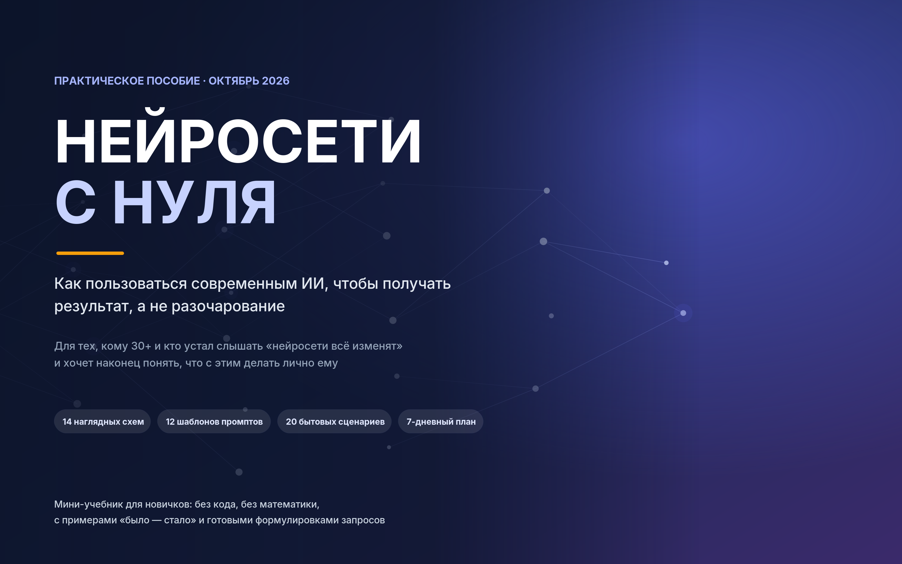

<p align="center">
  
</p>

<h1 align="center">Нейросети с нуля</h1>

<p align="center">
  Практическое пособие по современному ИИ для тех, кому 30+ и кто не айтишник.<br>
  Что такое нейросеть, как с ней разговаривать, где она врёт и как на ней не попасться мошенникам. Без хайпа, без снисходительности, без лишнего.
</p>

<p align="center">
  <a href="dist/neuroseti-s-nulya-A4.pdf"></a>
  <a href="dist/neuroseti-s-nulya-A5.pdf"></a>
  
  
  
  <a href="LICENSE"></a>
</p>

---

«Нейросети с нуля» — это книга, которую можно распечатать и прочитать за два-три вечера. Она для тех, кто слышал, что «нейросети всё умеют», один раз попробовал ChatGPT, получил какую-то ерунду и закрыл. Проблема почти никогда не в человеке и не в «неспособности к технологиям»: нейросеть — очень начитанный, быстрый и совершенно безынициативный помощник, который ничего не знает о вашей ситуации, пока вы ему не расскажете. Пособие учит именно этому — понятно ставить задачу, проверять ответ и не доверять там, где доверять нельзя.

Ориентир — Беларусь: цены в долларах, сервисы, которые здесь реально доступны, примеры из обычной жизни — работа, дом, деньги, дети, родители. Состояние рынка — октябрь 2026 года.

## Скачать

| Файл | Для чего |
|---|---|
| [`neuroseti-s-nulya-A4.pdf`](dist/neuroseti-s-nulya-A4.pdf) | Читать с экрана или печатать дома и в офисе на обычном принтере |
| [`neuroseti-s-nulya-A5.pdf`](dist/neuroseti-s-nulya-A5.pdf) | Брошюра A5 с зеркальными полями — печатается и сшивается как настоящая книга |

В обоих PDF есть закладки по главам, так что по файлу удобно перемещаться в любой программе для чтения.

## Для кого

- Вам 30+, у вас есть работа, семья и заботы, и на «разобраться с ИИ» нет лишних месяцев
- Вы не программист и не собираетесь им становиться
- Вы хотите, чтобы нейросеть экономила время, а не добавляла сомнений
- Вы хотите защитить родителей и детей от новых видов мошенничества — с поддельными голосами и видео

Порог входа — обычная фраза на русском языке. Технической подготовки не нужно.

## Что внутри

**Как читать пособие · Введение**

**Часть I. Понять**

1. Что такое нейросеть и почему она «понимает» слова
2. Восемь режимов работы
3. Кто есть кто: сервисы, модели и тарифы

**Часть II. Делать**

4. Интерфейс
5. Промпт: как просить, чтобы получать
6. Двенадцать шаблонов запросов

**Часть III. Не навреди**

7. Галлюцинации
8. Безопасность, данные и авторские права
9. ИИ против вас: мошенничество и как защитить близких — звонки клонированным голосом, дипфейки, ИИ-фишинг, фальшивые боты-«нейросети», семейное кодовое слово и что делать, если вас всё-таки обманули

**Часть IV. Практика**

10. Картинки, видео, голос и музыка
11. Документы, таблицы и «код для не-айтишников»
12. Двадцать сценариев: работа, дом, деньги, обучение — плюс раздел «Дети, школа и ИИ»
13. Продвинутый уровень: агенты, проекты, автоматизация

**Часть V. План действий**

14. Семь дней: пошаговый старт
15. Четыре уровня владения и двенадцать типичных ошибок
16. Куда всё движется

**Приложения**

- А. Глоссарий
- Б. Шпаргалка на холодильник
- В. Чек-листы
- Г. Источники
- Д. Рынок на октябрь 2026 — модели, цены и тарифы, то есть всё, что быстрее всего устаревает

В цифрах: **14 схем**, **12 шаблонов промптов**, **20+ сценариев** из жизни и **7-дневный план**, после которого нейросеть становится обычным рабочим инструментом.

Хотите сразу к делу — откройте главу 14 «Семь дней» и идите по ней, возвращаясь к теории по ссылкам.

## Важно

- Пособие образовательное. Это не юридическая, не медицинская и не финансовая консультация — по таким вопросам решение принимает специалист, а не чат-бот.
- Названия моделей, цены и интерфейсы сервисов меняются каждые несколько месяцев. Всё, что устаревает быстрее всего, собрано в одном месте — в приложении Д; если вы читаете это заметно позже октября 2026, сверьтесь с источниками из приложения Г.
- Нашли ошибку или устаревший факт — откройте [issue](https://github.com/lemitz/AI-from-scratch-RU/issues) или напишите на почту.

## Сборка

Исходник — один документ Word формата A4. Скрипт сборки через COM-автоматизацию Word делает из него версии A4 и A5 и экспортирует оба PDF с закладками.

Требования: Windows, установленный Microsoft Word и Python 3 с `lxml` (`pip install lxml`).

```powershell
powershell -ExecutionPolicy Bypass -File build\build.ps1
```

Готовые файлы появляются в `dist\`. Править текст нужно только в `src\Нейросети_с_нуля.docx` — версия A5 и оба PDF собираются из него.

## Структура проекта

```
src/
  Нейросети_с_нуля.docx      исходник книги, A4, правится в Word
build/
  build.ps1                  сборка: A4 + A5, экспорт обоих PDF
  make_a5.py                 пересчёт вёрстки A4 → A5 (поля, таблицы, картинки, шрифты)
  export_pdf.ps1             Word COM: обновляет оглавление и сохраняет PDF с закладками
dist/
  neuroseti-s-nulya-A4.pdf   A4: читать с экрана, печатать дома или в офисе
  neuroseti-s-nulya-A5.pdf   A5-брошюра: зеркальные поля, как у книги
assets/
  cover.png                  обложка
LICENSE                      CC BY-NC-SA 4.0
```

## Лицензия

Пособие распространяется по лицензии [Creative Commons BY-NC-SA 4.0](LICENSE): его можно свободно копировать, распечатывать, раздавать и переделывать при трёх условиях — указывать автора и ссылку на оригинал, не использовать в коммерческих целях и распространять производные материалы под той же лицензией. Распечатать для родителей, коллег или учеников — можно и нужно. Продавать — нельзя.

## Автор

[lemitz](https://github.com/lemitz), Гродно, Беларусь.

<p align="center">
  <a href="https://about.kobyla.by"></a>
  <a href="https://www.linkedin.com/in/lemitz/"></a>
  <a href="https://t.me/LemiTZ"></a>
  <a href="mailto:hello@kobyla.by"></a>
  <a href="https://github.com/lemitz"></a>
</p>

---

<p align="center">
  <br>
  <sub>Пособие подготовлено с помощью ИИ-инструментов.</sub>
</p>
